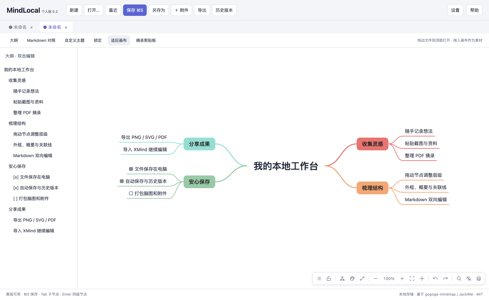

# MindLocal 本地脑图

一个可以在 Mac 上双击就用的思维导图应用。不联网、不要账号、不依赖其他软件，所有文件都留在你自己的电脑里。



> **本项目的定位**：这是基于 [gogoga-mindmap](https://github.com/JackWeiGogoga/gogoga-mindmap) 改造的**非官方独立桌面版**，与原作者没有隶属关系。上游是一个很优秀的网页脑图项目，本项目在它基础上加了桌面封装、本地文件管理、多标签、附件与 PDF 阅读等能力。

## 下载安装

到 [版本发布页](https://github.com/shiyuenianwu/mindlocal/releases) 下载最新的安装包，解压后把 `MindLocal.app` 拖进「应用程序」文件夹即可。

**当前只提供苹果芯片版**（M 系列芯片的 Mac）。视窗芯片的机器暂时没有包。

### 第一次打开会被系统拦住，这是正常的

本应用**没有申请苹果开发者公证**，属于本地临时签名。所以第一次双击会提示「无法打开，因为 Apple 无法验证此 App 是否包含恶意软件」。这不是软件有问题，是没有付费开发者账号的必然结果。三种解法任选一种：

1. 在应用图标上**右键**，选「打开」，在弹窗里再点一次「打开」
2. 打开「系统设置 → 隐私与安全性」，往下滚，点「仍要打开」
3. 在终端里执行：`xattr -d com.apple.quarantine /Applications/MindLocal.app`

只有第一次需要这么做，之后正常双击就行。

## 能做什么

**编辑**
双击节点编辑文字，`Tab` 添加子节点，`Enter` 添加同级节点，`⌘Z` 撤销。支持外框、概要、标注、关联线、自由主题、节点表格、节点编号，这些是上游原版就有的右键菜单能力。

**素材**
点「附件」可以放图片、PDF、Office 文档等，也可以把文件直接拖进画布，或者粘贴截图。节点上的图片能查看大图，文档附件点击调用系统阅读器，PDF 在应用内的独立窗口阅读。读 PDF 时复制文字，回到脑图点「摘录剪贴板」就能引进来。

**两套视图**
顶部可以切换大纲视图和 Markdown 对照视图。大纲支持定位和双击编辑。

**导入导出**
能导入 `.xmind`，多个工作表会变成多个标签页，无法转换的内容会给出提示。导出支持 PNG、SVG、PDF、复制图片、以及「脑图加附件」打包成 ZIP。

**外观**
内置主题、自定义主题、深色界面、字号与间距都可调。支持数学公式和 Markdown 备注预览。

## 保存

- `⌘S` 保存，第一次保存需要选文件位置
- 默认每约 5 秒自动保存已有名字且有改动的文档，可在设置里关掉
- 图片和附件会复制到脑图旁边的「文件名.assets」目录
- **移动脑图文件时要带上那个附件目录**，或者用「导出 → 脑图加附件 ZIP」来分享
- 覆盖写入前会留历史文本，能在「历史版本」里作为新标签打开
- 检测到磁盘文件被别的程序改过或删掉时会停止保存，避免覆盖掉别人的修改
- 多标签的草稿和视图状态存在本机应用数据目录，重启能恢复

## 已知限制

这些是当前版本真实存在的边界，写在这里免得你踩坑：

- PDF 是独立阅读窗口加复制摘录，还不是阅读器和脑图同窗分栏联动，也没有区域截图和定位回跳
- 大纲还没搬齐上游原版的全部键盘操作
- 自定义主题目前只能编辑一套个人主题
- 视频内嵌只放行常见播放器域名，本地视频内嵌未适配
- 没有自定义快捷键管理、正式安装器、自动更新
- 不会抢占系统默认的 Markdown 打开方式，需要时用访达的「打开方式」选择
- 没做过大规模节点性能测试，也没测过所有 XMind 历史版本的兼容性
- 原版复杂菜单已经复用，但并非所有组合操作都逐项验收过。**重要的脑图请另外保留一份备份**

**明确不做**：间隔复习、内置 AI 功能、Obsidian 双链与插件联动。

## 从源码构建

```bash
cd source
npm install
npm run build     # 把 app.ts 打包成 app.js
npm start         # 启动应用
```

`source/` 里面是桌面封装和上游源码：

- `main.cjs`、`preload.cjs`：Electron 主进程与预加载脚本
- `app.ts`：改造部分的源码，用 esbuild 打包成 `app.js`
- `index.html`、`shell.css`、`shell.js`、`styles.css`：界面
- `upstream/src/`：上游原项目的源码
- `licenses/`：随包分发的第三方依赖许可全文

## 来源与致谢

**这个项目能存在，全靠 JackWei 的开源工作。**

- 上游项目：[gogoga-mindmap](https://github.com/JackWeiGogoga/gogoga-mindmap)
- 作者：JackWei
- 本项目基于的版本：上游 1.0.0，提交 `22bd6a1d73a4ffe9455bedae4bf6932d0de2aa0b`
- 上游许可：MIT

上游把脑图的核心能力做得很扎实，节点操作、右键菜单、主题、公式、XMind 导入这些都不是我写的。我做的是在外面加一层桌面外壳、把文件保存和附件管理接到本地磁盘、加了多标签和 PDF 阅读。**如果这个项目对你有用，请先去给上游点个星。**

## 许可

MIT。本项目遵循上游的许可协议。

- 本项目的改造与封装部分：Copyright (c) 2026 shiyuenianwu
- 上游原项目：Copyright (c) 2026 JackWei

完整许可见 [LICENSE](LICENSE) 与 [LICENSE-upstream.txt](LICENSE-upstream.txt)，随包分发的第三方依赖许可见 [source/licenses](source/licenses)。

## 其他

使用说明的原始文本保留在 [使用说明.txt](使用说明.txt)。
